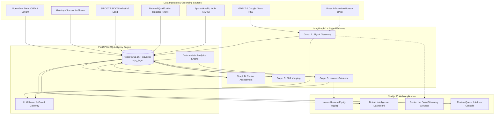
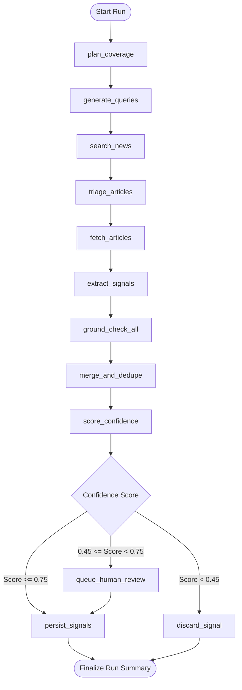
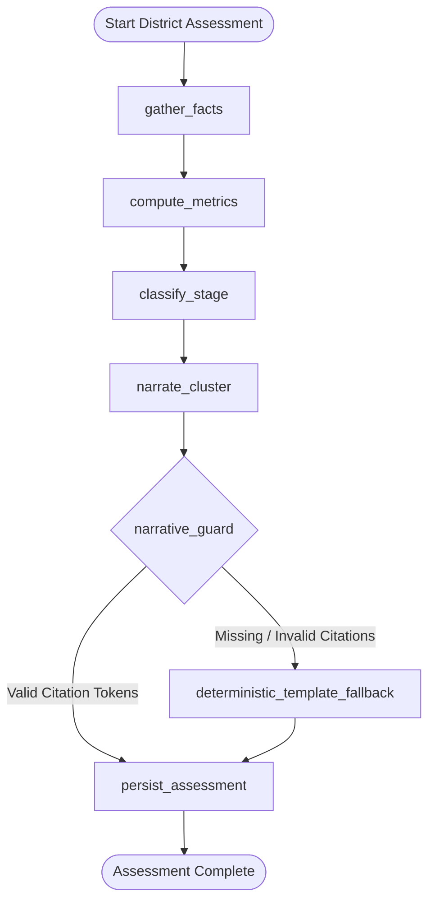
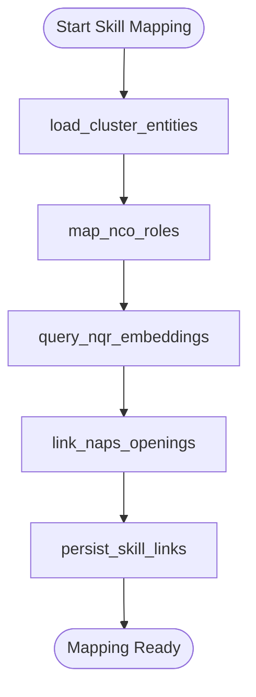
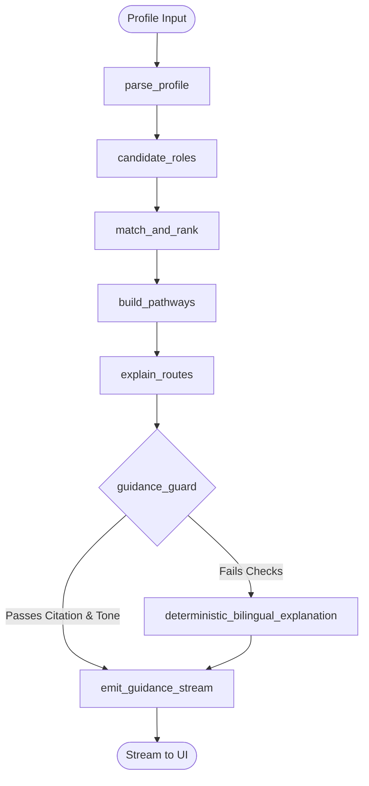
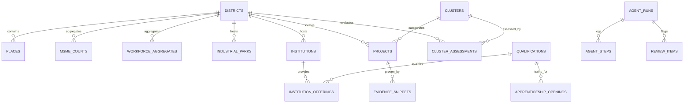

# KaushalSetu (कौशल सेतु) — System Architecture

> **Agentic AI platform detecting emerging industries in Tier-2/3 Indian districts and guiding learners to local jobs.**

---

## 1. High-Level System Architecture

KaushalSetu separates deterministic reference and structured data ingestion from autonomous agent intelligence and human-in-the-loop review.

---

## 2. Agent Workflow Graphs

### Graph A — Signal Discovery (`agents/graphs/signal_discovery.py`)
Discovers early industrial investments, capacity expansions, and SEZ developments from public press releases and official gazettes.

### Graph B — Cluster Assessment (`agents/graphs/cluster_assessment.py`)
Evaluates cluster momentum, depth, and infrastructure readiness to classify industrial stages and compute demand-supply deficits.

### Graph C — Skill Mapping (`agents/graphs/skill_mapping.py`)
Maps identified industrial clusters to standard National Classification of Occupations (NCO-2015) codes, NQR vocational qualifications, and NAPS apprenticeship trades.

### Graph D — Learner Guidance (`agents/graphs/learner_guidance.py`)
Translates learner profiles into hyper-local 4-step routes (`Course → Apprenticeship → Employer → Job Role`) with an explicit equity toggle.

---

## 3. Database Entity Relationship (ER) Model

---

## 4. Provenance & Hallucination Defenses

1. **Provenances:** Every database row carries a `provenance_label`:
   - `REAL`: Ingested directly from official government APIs or gazettes.
   - `ESTIMATED`: Extracted by verified LLM pipelines with string evidence matching.
   - `MOCK`: Synthetic test fixtures for testing and demo modes.
2. **Grounding Guard (`ground_check`):**
   - RapidFuzz string comparison (`partial_ratio >= 92`) between extracted claim and article source text.
   - Mandatory investment (₹ crore) and job count substring verification.
   - LGD Gazetteer alias resolution (e.g. Hosur → Krishnagiri `582`).
3. **Narrative Guard (`narrative_guard`):**
   - Asserts that every paragraph in cluster narratives includes verified citation tokens (`[P:id]`, `[M:nic]`, `[I:id]`, `[D:indicator]`).
   - Deterministic template fallback triggered if an LLM hallucinates citations.
4. **Privacy & Data Protection:**
   - Worker micro-aggregates in eShram with counts $< 10$ are strictly suppressed.
   - Learner guidance is 100% anonymous; zero personally identifiable information (PII) is persisted.

